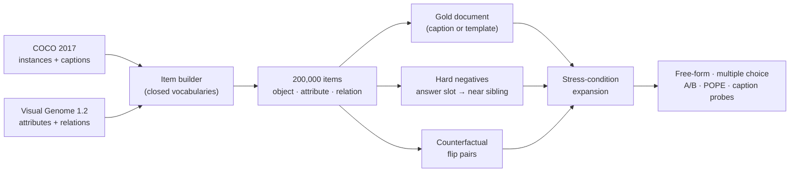
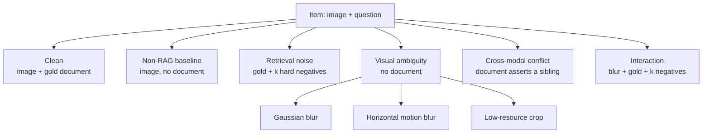
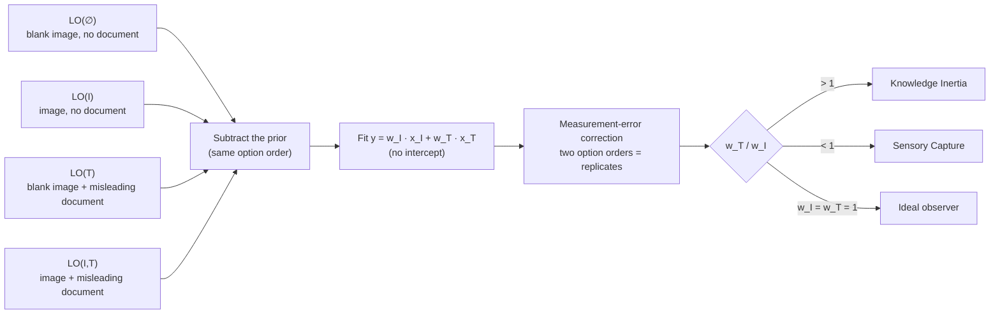
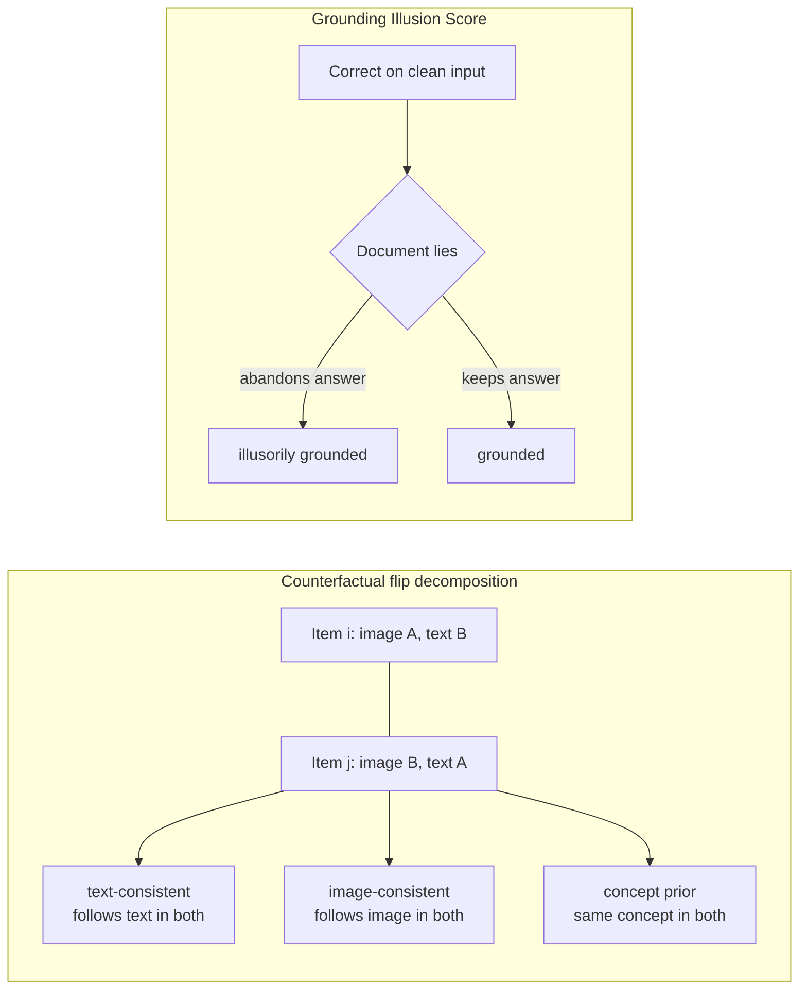
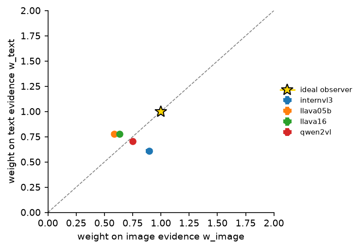
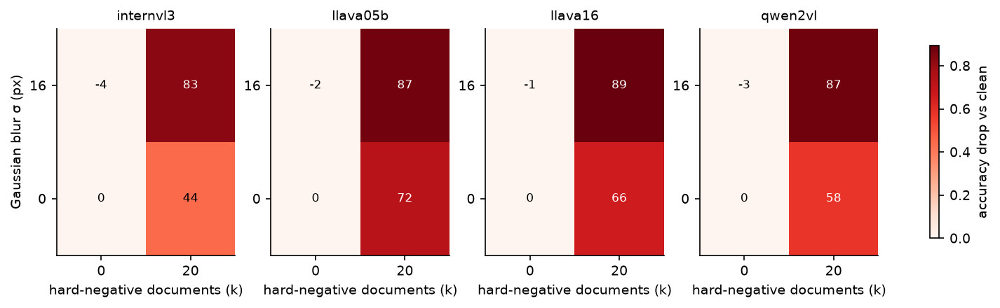
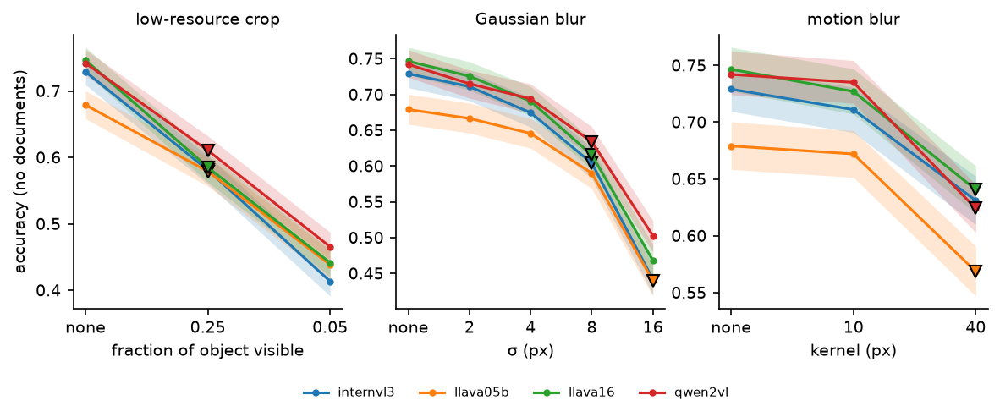
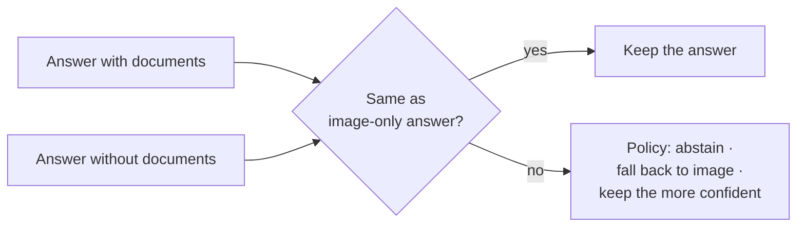
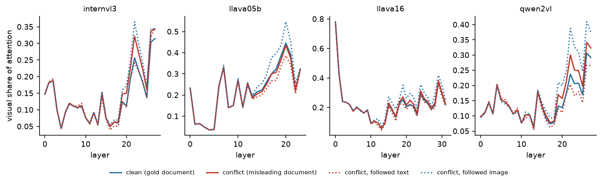
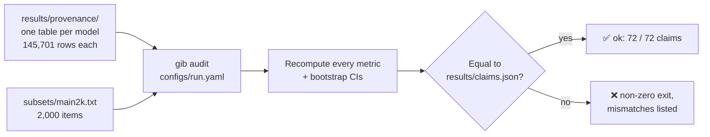

<div align="center">

# 🔍 GIB-200K

### The Illusion of Grounding: Do Vision–Language Models Weigh Retrieved Text and Images Like an Ideal Observer?

<p>
  
  
  
  
  
</p>

<p>
 
  <a href="https://arxiv.org/abs/2611.23127"></a>
  
  
  
  
  
</p>

<p>
  <strong>A diagnostic benchmark for multimodal retrieval-augmented generation under retrieval noise, visual ambiguity and cross-modal conflict, with an ideal-observer test of how vision–language models combine retrieved text and images.</strong>
</p>

<p>
  <a href="#-overview">Overview</a> ·
  <a href="#-the-benchmark">Benchmark</a> ·
  <a href="#-the-ideal-observer-test">Method</a> ·
  <a href="#-key-results">Results</a> ·
  <a href="#-verify-every-number">Verify</a> ·
  <a href="#-reproduction">Reproduction</a> ·
  <a href="#-repository-map">Repository</a> ·
  <a href="#-citation">Citation</a>
</p>

</div>

---

## 🔬 Overview

Retrieval-augmented vision–language models (VLMs) answer from **two sources of evidence that can each fail**: the retrieved text can be wrong or noisy, and the image can be degraded or contradicted. It is no surprise that models get worse when evidence is corrupted. The real question is whether a model **weighs** its two sources sensibly:

> An image the model can barely see **should** lose to a clear document, and a clear image should **not** lose to a document that merely asserts the opposite.

Accuracy curves cannot tell these cases apart. **GIB-200K** therefore compares models with a normative reference, the **ideal observer** of perceptual cue combination, which combines conditionally independent cues by adding their log-likelihood ratios. This gives a falsifiable prediction for every model and every item, and turns two informally named failure modes into formal, measurable quantities:

| Failure mode | Formal definition | Meaning |
|---|---|---|
| **Knowledge Inertia** | $w_T / w_I > 1$ | text evidence over-weighted relative to the model's own image evidence |
| **Sensory Capture** | $w_T / w_I < 1$ | image evidence over-weighted relative to the text |

### At a glance

| | |
|---|---|
| 🧱 **Benchmark** | 200,000 image–question items from COCO and Visual Genome, closed answer vocabularies, deterministic scoring (no LLM judge) |
| 🎛️ **Stress axes** | hard-negative retrieval noise (1–20 documents) · Gaussian/motion blur and low-resource crops · cross-modal conflict with counterfactual flip pairs |
| 📐 **Method** | ideal-observer cue-combination test with a measurement-error-corrected estimator (validated on planted weights) |
| 🧪 **Evaluation** | 4 open VLMs on one frozen, seeded split of 2,000 items · 145,701 queries per model |
| 🔁 **Auditability** | every open-model number is recomputed from released per-instance predictions by one command |

---

## 🎯 Central Research Question

GIB-200K goes beyond asking:

> **Does a vision–language model get the answer right?**

It asks:

> **When retrieved text and the image disagree, does the model weigh each source by how reliable it actually is — and how much of its "grounded" accuracy really comes from the image?**

---

## 🧱 The Benchmark



**Items.** Every item is a COCO image with a question whose answer comes from a closed vocabulary, so free-form answers are scored deterministically.

| Question type | Source | Vocabulary |
|---|---|---|
| **Object** — *"What animal is shown in the image?"* | COCO | 11 category groups; one annotated category of the group, largest instance ≥ 4% of the image |
| **Attribute** — *"What color is the bus?"* | Visual Genome | 11 colours; object name unique in the image |
| **Relation** | Visual Genome + COCO boxes | 8 spatial predicates, plus left/right from COCO boxes |

**Hard negatives.** Each distractor is the gold document with its answer slot replaced by a semantically near sibling (a co-occurring category of the same group, the perceptually nearest colour, or the antonym predicate first, e.g. *on ↔ under*). Distractors are close but factually wrong, and differ from the gold document only in the claim.

**Counterfactual flip pairs.** Item *i* (image shows A, document claims B) is paired with item *j* (image shows B, document claims A), which separates *following the text* from *preferring a concept*.

### Stress conditions



| Axis | Condition | Levels evaluated in the paper | Full benchmark |
|---|---|---|---|
| clean | image + gold document | – | – |
| non-RAG baseline | image, no document | – | – |
| retrieval noise | gold + k hard negatives | k ∈ {1, 5, 20} | {1, 3, 5, 10, 20} |
| visual ambiguity | Gaussian blur, no document | σ ∈ {2, 4, 8, 16} px | {1, 2, 4, 8, 16} |
| | horizontal motion blur | {10, 40} px | {5, 10, 20, 40} |
| | low-resource crop | {25, 5}% of object visible | {50, 25, 10, 5} |
| conflict | document asserts a sibling | blur σ ∈ {4, 16} | {0, 4, 16} |
| interaction | blur + gold + k negatives | σ = 16 × k ∈ {0, 20} | σ ∈ {4, 16} × k ∈ {0, 5, 20} |

Images are standardised to 640 px on the longer side before degradation, so a given σ means the same on every photograph. Every condition is asked as a free-form question and as a multiple-choice question (five options; two for left/right questions); conflict items also get a binary A/B probe in **both** option orders.

**Full build (seed 0):** 200,000 items on 90,708 images · 81,235 counterfactual flip pairs · 191,140 train2017 / 8,860 val2017 items.

---

## 📐 The Ideal-Observer Test

An ideal observer that combines conditionally independent cues with Bayes' rule, $P(y \mid I,T) \propto P(I \mid y)\,P(T \mid y)\,P(y)$, satisfies in log-odds of the text's claim against the image's answer:

$$
\mathrm{LO}(I,T)-\mathrm{LO}(\varnothing) \;=\; \big[\mathrm{LO}(I)-\mathrm{LO}(\varnothing)\big] \;+\; \big[\mathrm{LO}(T)-\mathrm{LO}(\varnothing)\big]
$$



Every term is measured **on the same item**, at blur σ ∈ {0, 4, 16}. Because $x_I$ and $x_T$ are noisy, ordinary least squares shrinks both weights towards zero (regression dilution). The two option orders are independent replicates, so with averages $X, y$ and replicate differences $\Delta X, \Delta y$:

$$
\hat{w} = \Big(M_{XX} - \tfrac14\,\mathrm{Cov}(\Delta X)\Big)^{-1}\Big(M_{Xy} - \tfrac14\,\mathrm{Cov}(\Delta X,\Delta y)\Big)
$$

On simulated models with planted weights, the corrected estimator recovers them, while least squares is biased towards zero (`tests/test_recovery.py`).

### Two confound-separating analyses



- **Flip decomposition** — a single-direction conflict test cannot tell *follows the text* from *prefers concept B anyway*; the flip pair can.
- **Grounding Illusion Score** — $\mathrm{GIS} = P(\text{follows text in conflict} \mid \text{correct in clean})$: how much clean accuracy is not grounded in the image.

---

## 📊 Key Results

All four open models answer the **same 2,000 items** (frozen, seeded split; checksum `d04122653ff2360bab2d02269240c79a`). Intervals are 95% bootstrap CIs with images as clusters (2,000 resamples).

### 🏆 Headline

| Model | Acc. clean | Acc. adverse | ECE adverse | R | Trust Index | GIS | w_T / w_I |
|---|---:|---:|---:|---:|---:|---:|---:|
| **InternVL3-8B** | 0.927 [0.916, 0.938] | **0.599** [0.585, 0.614] | 0.213 | **0.509** | 0.20 [0.16, 0.24] | **0.348** | 0.68 [0.66, 0.70] |
| **Qwen2-VL-7B** | **0.942** [0.932, 0.952] | 0.548 [0.533, 0.562] | **0.156** | 0.491 | 0.58 [0.52, 0.64] | 0.479 | 0.94 [0.92, 0.96] |
| **LLaVA-1.6-Mistral-7B** | 0.939 [0.928, 0.949] | 0.486 [0.473, 0.500] | 0.303 | 0.361 | 3.72 [3.24, 4.29] | 0.623 | 1.23 [1.19, 1.27] |
| **LLaVA-Interleave-0.5B** | 0.925 [0.914, 0.937] | 0.413 [0.400, 0.426] | 0.200 | 0.357 | 2.71 [2.48, 2.95] | 0.714 | 1.32 [1.28, 1.37] |

R = (acc adverse / acc clean) × (1 − ECE adverse) · TI > 1: text wins under conflict, TI < 1: image wins · GIS = Grounding Illusion Score.

Models differ reliably in adverse accuracy: Friedman χ²(3) = 755.7, p = 1.8 × 10⁻¹⁶³, Kendall's W = 0.13, n = 2,000 items; repeated-measures ANOVA F(3, 5997) = 403.9, partial η² = 0.17; all pairwise differences significant after Holm correction.

### 🧠 Findings

| # | Finding |
|---|---|
| **1** | **Accurate when clean, fragile under stress.** Clean accuracy 92.5%–94.2%; adverse accuracy falls to 41.3%–59.9%. |
| **2** | **Retrieval noise is the steepest axis.** Accuracy falls monotonically with the number of hard negatives (−0.557 to −0.854 log-odds per doubling of 1 + k), and blur and retrieval noise compound super-additively for every model. |
| **3** | **No model is an ideal observer.** w_I ranges 0.586–0.895 and w_T 0.609–0.777, never both 1. |
| **4** | **Different models fail in opposite directions.** Both LLaVA models show Knowledge Inertia (w_T/w_I = 1.229, 1.322); InternVL3 shows Sensory Capture (0.680); Qwen2-VL is nearly balanced (0.937). |
| **5** | **Much apparent text-following is a concept prior.** Concept priors explain 27.9%–40.6% of flip pairs; for LLaVA-1.6 they are as common as genuine text-following. |
| **6** | **Clean accuracy is partly an illusion.** Between 34.8% and 71.4% of correct clean answers are abandoned when the document lies. |
| **7** | **A free consistency check helps — with a caveat.** Falling back to the image-only answer when answers disagree raises accuracy under misleading documents, but hurts when the image is heavily degraded. |

### 📐 Cue-combination weights (ideal observer: w_I = w_T = 1)

| Model | w_I | w_T | w_T / w_I | Diagnosis |
|---|---:|---:|---:|---|
| InternVL3-8B | 0.90 [0.87, 0.92] | 0.61 [0.59, 0.62] | 0.68 [0.66, 0.70] | Sensory Capture |
| Qwen2-VL-7B | 0.75 [0.73, 0.77] | 0.70 [0.69, 0.72] | 0.94 [0.92, 0.96] | nearly balanced (slight Sensory Capture) |
| LLaVA-1.6-Mistral-7B | 0.63 [0.61, 0.65] | 0.78 [0.76, 0.79] | 1.23 [1.19, 1.27] | Knowledge Inertia |
| LLaVA-Interleave-0.5B | 0.59 [0.56, 0.61] | 0.78 [0.76, 0.79] | 1.32 [1.28, 1.37] | Knowledge Inertia |

<p align="center">
  
</p>

### 🔄 Modality bias or concept prior? (816 flip pairs per model)

| Model | text-consistent | image-consistent | concept prior |
|---|---:|---:|---:|
| InternVL3-8B | 0.152 | **0.520** | 0.328 |
| Qwen2-VL-7B | 0.183 | **0.467** | 0.350 |
| LLaVA-1.6-Mistral-7B | **0.409** | 0.185 | 0.406 |
| LLaVA-Interleave-0.5B | **0.565** | 0.156 | 0.279 |

### 📉 Retrieval-noise dose–response

| Model | k = 0 | k = 1 | k = 5 | k = 20 | decay (log-odds / doubling) | super-additive drop |
|---|---:|---:|---:|---:|---:|---:|
| InternVL3-8B | 0.927 | 0.812 | 0.693 | 0.487 | −0.56 [−0.59, −0.52] | 0.43 [0.41, 0.46] |
| Qwen2-VL-7B | 0.942 | 0.800 | 0.584 | 0.366 | −0.73 [−0.77, −0.69] | 0.33 [0.31, 0.35] |
| LLaVA-1.6-Mistral-7B | 0.939 | 0.759 | 0.544 | 0.281 | −0.79 [−0.83, −0.75] | 0.24 [0.22, 0.26] |
| LLaVA-Interleave-0.5B | 0.925 | 0.701 | 0.381 | 0.202 | −0.85 [−0.90, −0.82] | 0.17 [0.15, 0.19] |

<p align="center">
  
</p>

<p align="center">
  
</p>

### 🛡️ From diagnosis to mitigation: a training-free consistency gate

Because every question is also asked without documents, a deployable check comes at no extra cost: **if the answer changes when the documents are removed, the documents are suspect.**



| Setting | Δ accuracy, fall back to image-only answer |
|---|---|
| Misleading document (conflict) | **+0.19 to +0.44** across models |
| 20 hard negatives | **+0.24 to +0.48** across models |
| Correct document, heavily blurred image (σ = 16) | **−0.47 to −0.53** across models |

The check works as a monitoring signal for retrieval-augmented systems with good images, not as a universal fix.

<p align="center">
  
</p>

More figures: [`results/figures/`](results/figures/) · full tables: [`results/RESULTS.md`](results/RESULTS.md) · qualitative failures: [`results/gallery.html`](results/gallery.html)

---

## 📏 Metrics: which question each one answers

| Question | Metric |
|---|---|
| Is the model right, and does it stay right under stress? | accuracy, adverse accuracy, **robustness coefficient R** |
| Is it confidently wrong? | ECE, confident-wrong rate |
| When image and text disagree, which wins? | **Trust Index**, conflict matrix |
| Does it weigh the evidence like an ideal observer? | **cue-combination weights**, integration errors |
| Is the "bias" about modality, or about the concept? | **flip decomposition** |
| Is its clean accuracy actually grounded in the image? | **Grounding Illusion Score**, grounded accuracy, illusion gap |
| How much does retrieval move it, for good and for bad? | context-sensitivity ratios (ReFinD-style) |
| How fast do noise and blur hurt it? | decay rate, retained AUC, resolution thresholds |
| Do stressors compound? | super-additive drop, vulnerability heatmap |
| Does it name objects that are not there? | CHAIR, POPE |
| Is attention collapse a signature of text-following? | per-layer attention shift, AUROC |
| Can failures be caught at test time? | consistency gate, error-signal AUROCs |
| Can this model's probabilities be trusted at all? | probability quality (usable share, format mass) |

Definitions, motivation and estimators: [`docs/METRICS.md`](docs/METRICS.md).

---

## ✅ Verify Every Number

Every open-model number in the paper is a pure function of the released per-instance tables. The audit recomputes all reported claims and **fails loudly on any mismatch**.



```bash
python -m gib build --coco-root data/coco --vg-root data/vg --splits val2017,train2017 --out data/gib200k
python -m gib audit --data data/gib200k --report results --config configs/run.yaml
```

The first command rebuilds `items.jsonl` from the public COCO and Visual Genome annotations (see [`docs/RUNBOOK.md`](docs/RUNBOOK.md), steps 1–2); the second recomputes all 72 claims and prints `"ok": true`.

---

## 🧪 Reproduction

### 1. Clone and install

```bash
git clone https://github.com/Basavarajearlybird/GIB-200K.git
cd GIB-200K
pip install -r requirements.txt            # build, analysis, report (CPU)
pip install -r requirements-gpu.txt        # open models (CUDA GPU)
pip install -r requirements-api.txt        # closed models (optional)
```

### 2. Tests and an offline end-to-end run

```bash
python -m pytest -q                        # unit, known-answer and pipeline tests
python -m gib demo --out demo_out          # full pipeline on synthetic fixtures with SIMULATED models
```

### 3. Build the benchmark (CPU, ~3 minutes)

```bash
python -m gib build --coco-root data/coco --vg-root data/vg --splits val2017,train2017 --out data/gib200k
python -m gib fetch-images --data data/gib200k --subset eval --image-root data/coco
```

### 4. Evaluate a model (resumable)

```bash
python -m gib evaluate --data data/gib200k --image-root data/coco --runs runs \
    --model llava16=hf:llava-hf/llava-v1.6-mistral-7b-hf --load-4bit
```

### 5. Report and audit

```bash
python -m gib report --data data/gib200k --image-root data/coco --runs "runs/*" --out reports/main
python -m gib audit  --data data/gib200k --report reports/main
```

**To reproduce the paper exactly**, use the 2,000-item split [`subsets/main2k.txt`](subsets/main2k.txt) with [`configs/run.yaml`](configs/run.yaml). The complete step-by-step pipeline, compute estimates and self-checks are in [`docs/RUNBOOK.md`](docs/RUNBOOK.md).

### Models and compute

| Model | Hugging Face id | Commit | Weights | Wall-clock (h) |
|---|---|---|---|---:|
| InternVL3-8B | `OpenGVLab/InternVL3-8B-hf` | `259a3b6` | 4-bit NF4 | 16.7 |
| LLaVA-1.6-Mistral-7B | `llava-hf/llava-v1.6-mistral-7b-hf` | `2424fdd` | 4-bit NF4 | 8.5 |
| Qwen2-VL-7B-Instruct | `Qwen/Qwen2-VL-7B-Instruct` (max 401,408 pixels) | `eed1309` | 4-bit NF4 | 10.0 |
| LLaVA-Interleave-Qwen-0.5B | `llava-hf/llava-interleave-qwen-0.5b-hf` | `1090956` | bfloat16 | 1.4 |

One NVIDIA RTX 4090 (24 GB), two runs sharing the GPU · transformers 4.57.3 · PyTorch 2.8 · bitsandbytes 0.50 · greedy decoding · every run answered all 145,701 queries without errors.

**Efficient inference.** All queries on an image share the image prefix, encoded once and reused through the key–value cache; probe distributions are read from a single next-token distribution. Each run checks the cached computation against a plain forward pass and falls back automatically if they disagree.

---

## 📁 Repository Map

```text
GIB-200K/
│
├── README.md
├── LICENSE
├── CITATION.cff
├── pyproject.toml
├── requirements.txt            # core (CPU)
├── requirements-gpu.txt        # open models
├── requirements-api.txt        # closed models
│
├── configs/
│   ├── default.yaml            # full benchmark, all levels
│   ├── lite.yaml               # single-GPU / small-budget profile
│   └── run.yaml                # configuration used in the paper
│
├── subsets/
│   └── main2k.txt              # the frozen 2,000-item evaluation split
│
├── gib/                        # the benchmark package (python -m gib ...)
│   ├── build/                  # COCO + Visual Genome item builder, flip pairing
│   ├── axes/                   # stress-condition expansion and image degradation
│   ├── models/                 # Hugging Face, API and simulated model adapters
│   ├── eval/                   # metrics, statistics, consistency gate, taxonomy
│   ├── report/                 # report, figures, gallery, macros, audit
│   ├── human/                  # human-study and taxonomy-validation tools
│   ├── release/                # dataset export and reproducible source packing
│   └── latex/                  # LaTeX / Word table rendering
│
├── tests/                      # unit, known-answer, recovery and pipeline tests
│
├── docs/
│   ├── METRICS.md              # every metric: definition, motivation, estimator
│   └── RUNBOOK.md              # from annotations to an audited report
│
└── results/
    ├── provenance/             # per-instance predictions, one table per model
    ├── claims.json             # every reported claim (checked by the audit)
    ├── report.json             # all metrics with confidence intervals
    ├── RESULTS.md              # human-readable result tables
    ├── items.txt               # items the report covers
    ├── macros.tex              # LaTeX macros generated from claims.json
    ├── gallery.html            # qualitative failure gallery
    └── figures/                # all figures + CAPTIONS.md
```

---

## ⚖️ Scope & Limitations

- The paper evaluates a seeded **2,000-item split** of the 200,000 items with a reduced level set, and **four open models**, three of them in 4-bit quantisation without a full-precision comparison. Results on the full benchmark, larger models and closed models may differ.
- No human baseline was run, and the rule-based failure taxonomy was not validated against human labels (tooling for both is included in `gib/human/`).
- Closed answer vocabularies make scoring exact but restrict the question types; Visual Genome attributes are noisy.
- Attention is treated as a **correlational** signal, not an explanation.
- The train2017/val2017 split is a proxy for exposure to COCO during instruction tuning, not proof of it.

---

## 🔐 Data, Licence & Ethics

- **Code:** MIT ([`LICENSE`](LICENSE)). **Annotations:** CC BY 4.0.
- All images and annotations come from public datasets (COCO, Visual Genome). COCO images are **not redistributed**, except 16 example images embedded in `results/gallery.html` (and the gallery figure) under their original COCO/Flickr licences.
- No human-subject data were collected.

---

## 📜 Citation

If you use GIB-200K, please cite the technical report, [arXiv:2611.23127](https://arxiv.org/abs/2611.23127) (metadata also in [`CITATION.cff`](CITATION.cff)):

```bibtex
@article{rm2026gib,
  title   = {The Illusion of Grounding: Do Vision-Language Models Weigh Retrieved Text and Images Like an Ideal Observer?},
  author  = {{Basavaraj R M} and Chandel, Harshal},
  journal = {arXiv preprint arXiv:2611.23127},
  year    = {2026},
  doi     = {10.48550/arXiv.2611.23127}
}
```

---

<div align="center">

### 🔍 GIB-200K

**Do vision–language models weigh retrieved text and images like an ideal observer?**

<sub>200,000 items • 4 open VLMs • ideal-observer analysis • every number auditable</sub>

</div>
